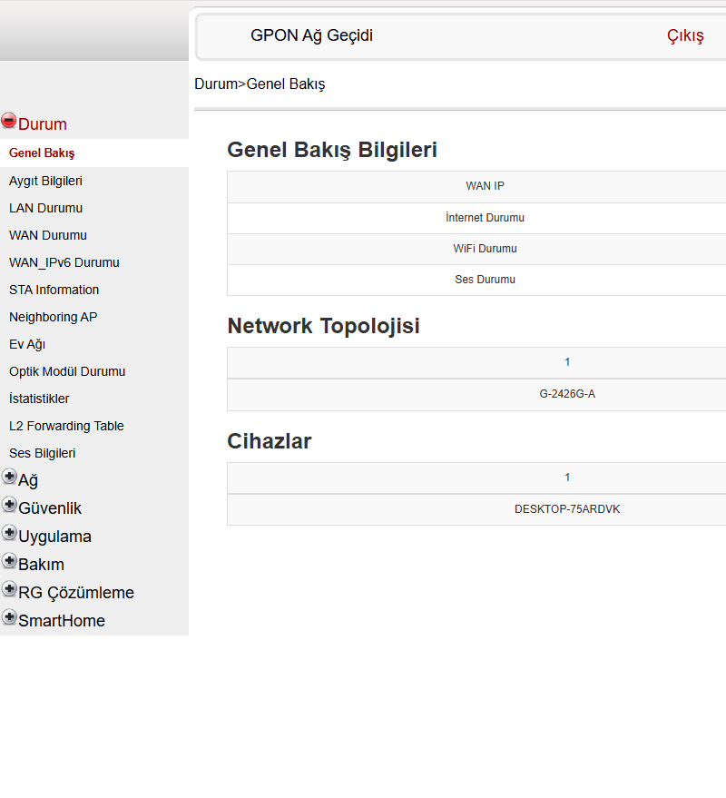
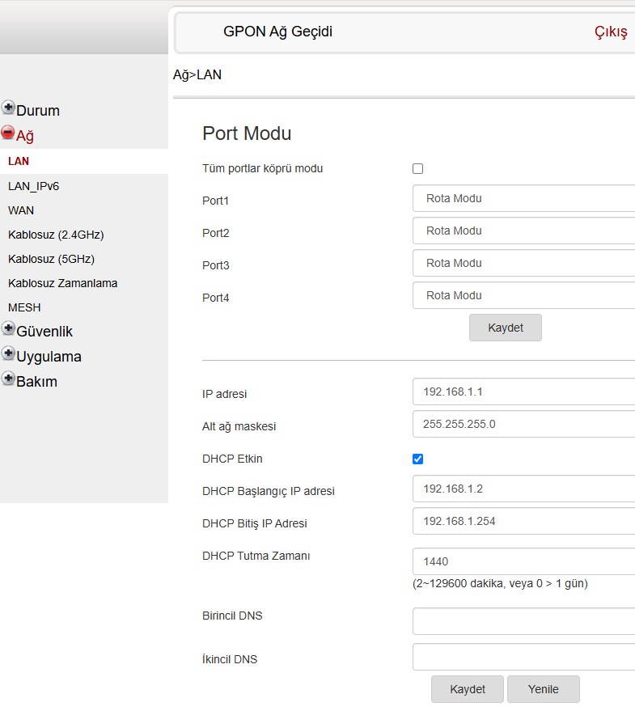
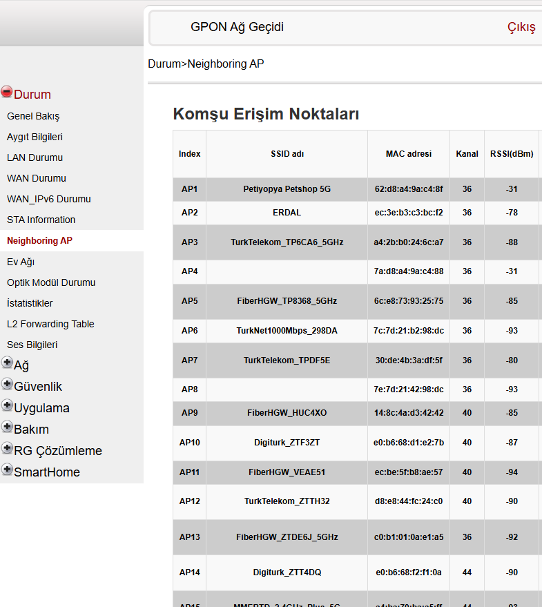

# Nokia G-2426G-A (Turkcell Superonline) — Özel Firmware, Kalıcı Root & Tam Özgürleştirme Rehberi

Bu depo; **Nokia G-2426G-A** (MediaTek MT7528/EN7528 MIPS32) GPON ONT / Router cihazı üzerinde servis sağlayıcı (Turkcell Superonline) kısıtlamalarını kaldırmak, kalıcı root yetkisi kazanmak, Köprü Modunu (Bridge Mode) aktifleştirmek ve gizli tüm donanımsal yönetim araçlarını açmak için yürütülen tersine mühendislik çalışmalarını, özel araçları ve adım adım kurulum yönergelerini içerir.

---

## 📸 Canlı Sistemden Doğrulama Ekran Görüntüleri

| Tam Açık Menü Ağacı (66 Sekme) | Açık & Düzenlenebilir LAN Sayfası | Canlı Çevre Wi-Fi Spektrum Taraması |
|:---:|:---:|:---:|
|  |  |  |

---

## 📌 İçindekiler
1. [Bölüm 1: Ev Kullanıcıları İçin Kolay Anlatım](#-bölüm-1-ev-kullanıcıları-için-kolay-anlatım-hızlı-rehber)
   - [Bu Proje Ne İşe Yarar?](#bu-proje-ne-işe-yarar)
   - [Neler Kazandık?](#neler-kazandık)
   - [Nasıl Uygulanır?](#nasıl-uygulanır)
2. [Bölüm 2: İleri Düzey & Mühendislik Detayları](#-bölüm-2-ileri-düzey--mühendislik-detayları-teknik-kılavuz)
   - [Donanım ve Sistem Mimarisi](#donanım-ve-sistem-mimarisi)
   - [MTD Flaş Bölüm Haritası](#mtd-flaş-bölüm-haritası)
   - [HDR2 Paket Formatı ve JAMCRC Algoritması](#hdr2-paket-formatı-ve-jamcrc-algoritması)
   - [U-Boot İmza Denetimi Bypassı](#u-boot-imza-denetimi-bypassı)
   - [Donanımsal MTD ioctl Keşifleri](#donanımsal-mtd-ioctl-keşifleri)
   - [Sistem Kararlılığı ve cfgmgr Çökme Analizi (RCA)](#sistem-kararlılığı-ve-cfgmgr-çökme-analizi-rca)
   - [Web UI ve RBAC Mimarisi](#web-ui-ve-rbac-mimarisi)
3. [Bölüm 3: Denenen Şeyler, Başarısızlıklar ve Alınan Dersler](#-bölüm-3-denenen-şeyler-başarısızlıklar-ve-alınan-dersler)
4. [Depo Klasör Yapısı](#-depo-klasör-yapısı)
5. [Sorumluluk Reddi (Disclaimer)](#-sorumluluk-reddi-disclaimer)

---

# 🏠 Bölüm 1: Ev Kullanıcıları İçin Kolay Anlatım (Hızlı Rehber)

### Bu Proje Ne İşe Yarar?
Turkcell Superonline tarafından fiber internet abonelerine verilen **Nokia G-2426G-A** modemler, servis sağlayıcı tarafından kilitlenmiştir. Modemin web arayüzüne girdiğinizde yerel ağ (LAN) ayarları, DNS değiştirme kutuları ve köprü modu seçenekleri gri renktedir (değiştirilemez). Ayrıca cihaz, internet servis sağlayıcınızın uzaktan erişimine (TR-069) açıktır ve kendi router'ınızı kullanmanıza izin vermez.

Bu proje, modemin içindeki yazılımı güvenli bir şekilde güncelleyerek bu cihazı **tam yetkili, bağımsız bir cihaza dönüştürür**.

### Neler Kazandık?
- 🌉 **Gerçek Köprü Modu (Bridge Mode):** Modemi yalın bir optik dönüştürücüye çevirebilir; arkasına Asus, Keenetic, OpenWrt, pfSense gibi dilediğiniz güçlü router'ı takarak tüm yönlendirmeyi kendi cihazınızdan yapabilirsiniz.
- 🔓 **Kilitli Menülerin ve Butonların Açılması:** Ağ (LAN) menüsündeki modem IP adresi, alt ağ maskesi, DHCP havuz başlangıç/bitişleri ve **Kaydet** butonları tamamen aktif ve düzenlenebilir hale getirildi.
- 🛡️ **Özel DNS Özgürlüğü:** Superonline'ın zorunlu DNS yönlendirmesi aşıldı; Cloudflare (`1.1.1.1`), Quad9 (`9.9.9.9`), Google DNS vb. doğrudan modem seviyesinde tanımlanabilir hale geldi.
- 🚫 **İnternet Servis Sağlayıcı Uzaktan Müdahalesinin Durdurulması:** Servis sağlayıcının (TR-069 CWMP) uzaktan modeminize erişmesi, ayarlarınızı sıfırlaması veya bilginiz dışında firmware yüklemesi engellendi.
- 📶 **Gizli Wi-Fi Spektrum Tarayıcısı:** Çevrenizdeki tüm komşu 2.4 GHz ve 5 GHz kablosuz ağları, sinyal güçlerini (dBm), kanal numaralarını ve kanal genişliklerini (80 MHz) anlık gösteren dahili tarayıcı (`Neighboring AP`) menüye eklendi.
- 📡 **Canlı Ağ Trafiği Yakalama (tcpdump):** Router üzerinden geçen ağ paketlerini web arayüzünden doğrudan `.pcap` (Wireshark) dosyası olarak kaydedebilme yeteneği açıldı.
- 💻 **Kalıcı Root Kabuk Erişimi:** Bilgisayarınızdan `telnet 192.168.1.1 2324` yazarak hiçbir şifreye ihtiyaç duymadan doğrudan `#` (root) yetkisiyle modemin Linux sistemine bağlanabilirsiniz. Cihaz elektrikten kesilip açılsa bile bu erişim otomatik olarak devam eder.

---

### Nasıl Uygulanır?

#### Gereksinimler:
- Bilgisayarınızda Python 3.8+ kurulu olmalıdır.
- Modem ile bilgisayarınız Ethernet kablosu ile bağlı olmalıdır (`192.168.1.X` bloğu).
- Modemin stok firmware paketi (ayrıştırılmış `rootfs.squashfs` ve çekirdek).

#### Adım 1: Dosya Sistemini Derleme (SquashFS)
Bu depoda `rootfs_patches/` altında yer alan yamalar kök dosya sistemine entegre edildikten sonra `mksquashfs` ile paketlenir:
```bash
cd tools/repack
mksquashfs rootfs_sq rootfs_v6.sqfs -comp lzma -b 128K -noappend -pf perms.pf
```

#### Adım 2: HDR2 Firmware İmajını Birleştirme
JAMCRC sağlamasını otomatik hesaplayarak U-Boot'un kabul edeceği ikili imajı üretin:
```bash
python repack_firmware.py --pkg /yol/stok_paket.bin --sqfs rootfs_v6.sqfs --out image_mod_v6_HDR2.bin
```

#### Adım 3: Güvenli Flaşlama (Boşta Olan Slota Yazma)
Cihaz çift yuva (Dual-Bank A/B) mimarisine sahip olduğundan, işlem çalışan sisteme değil **boşta olan yedek slota** yapılır:
```bash
python tools/flashing/flash_firmware.py --image image_mod_v6_HDR2.bin --http-server 192.168.1.8:8000 --target-slot image0
```
Bu betik hedef bölümü donanımsal olarak siler, blok blok yazar, MD5 sağlama kontrolü yapar ve başarılı olursa aktif slotu değiştirip modemi yeniden başlatır.

---

# 🔬 Bölüm 2: İleri Düzey & Mühendislik Detayları (Teknik Kılavuz)

### Donanım ve Sistem Mimarisi
- **SoC:** MediaTek / EcoNet MT7528 (EN7528)
- **CPU:** MIPS 1004Kc (32-bit Little-Endian, 4 thread, çift çekirdek)
- **RAM:** 512 MB DDR3 (~417 MB Linux çekirdeğine tahsisli)
- **Flaş:** 256 MB NAND Flash (Çift yuva A/B yerleşimi)
- **Çekirdek:** Linux 3.18.21 SMP

### MTD Flaş Bölüm Haritası
- `/dev/mtd0`: `bootloader` (U-Boot, 256 KB)
- `/dev/mtd2`: `image0` (Slot 0 Firmware, 41.5 MB)
- `/dev/mtd4`: `rootfs` / `image1` (Slot 1 Firmware, 37.3 MB)
- `/dev/mtd5`: `config` (UBIFS `/configs`, 8 MB)
- `/dev/mtd6`: `log` (UBIFS `/logs`, 12 MB)
- `/dev/mtd9` & `/dev/mtd10`: `flag` & `flagback` (A/B yuva yönetim bayrakları)
- `/dev/mtd11` & `/dev/mtd12`: `ri` & `riback` (Radyo / Üretici / Operatör kimlik bölümü)

### HDR2 Paket Formatı ve JAMCRC Algoritması
Firmware paketi 280 baytlık (`0x118`) bir başlıkla başlar. Başlığın `0x08` ofsetinde gövde uzunluğu, `0x0C` ofsetinde JAMCRC sağlama değeri, `0x50` ve `0x54` ofsetlerinde çekirdek ve kök dosya sistemi boyutları bulunur.

`libupgradeimpl.so` ikilisinden çıkarılan sağlama algoritması standart **CRC-32 / JAMCRC** (polinom `0xEDB88320` yansımalı, başlangıç `0xFFFFFFFF`, çıkış xor `0`) standardıdır:
$$\text{JAMCRC} = \text{zlib.crc32}(\text{kernel} + \text{rootfs} + \text{extra}) \oplus \text{0xFFFFFFFF}$$

### U-Boot İmza Denetimi Bypassı
Resmî güncelleme kanalları (`libupgrade.so`, web GUI, OMCI) `/usr/etc/buildinfo` içindeki `SIGN=y` parametresi nedeniyle Nokia PKCS#7 dijital imzasını şart koşar. 

Ancak önyükleyici (U-Boot 2016) kaynak kodları ve ikili analizi, çekirdeğin açılış anında kriptografik imza denetiminden geçirilmediğini; U-Boot'un yalnızca `HDR2` sihirli numarası ve başlık JAMCRC değerini doğrulayarak çekirdeği RAM'e açtığını (`Decompress kernel image to ram`) kanıtlamıştır. Bu sayede doğrudan MTD katmanına yazılan ve CRC'si doğru hesaplanmış modifiye imajlar U-Boot tarafından sorunsuz önyüklenir.

### Donanımsal MTD ioctl Keşifleri
Standart Linux `MEMERASE` (`0x40084D02`) sistem çağrısı bu MIPS çekirdeğinde `ENOTTY` hatası vermiştir. Canlı cihaz üzerinde MIPS assembler ile yapılan taramada çalışan gerçek donanım ioctl numaraları çözülmüştür:
- **`0x80084D02`:** `MEMERASE` (Donanımsal 256 KB blok silme)
- **`0x80084D7E`:** `MEMUNLOCK` (Donanımsal yazma kilidi açma)

Ayrıca karakter sürücüsü `/dev/mtdX` tampon yazımlarını `EINVAL` ile reddederken; çekirdeğin blok önbellek katmanını kullanan `/dev/mtdblockX` aygıtı `dd` yazımlarını eksiksiz kabul etmektedir.

### Sistem Kararlılığı ve cfgmgr Çökme Analizi (RCA)
İlk modifiye imajlarda görülen her ~11 dakikada bir yeniden başlama sorununun analizi:
1. Web açıklarıyla gönderilen parametre enjeksiyonları (`uname=ontadmin\n...`), sistem yönetim süreci `cfgmgr` tarafından XML veri tabanına (`FtpUserName`) kaydedilmiştir.
2. Yaklaşık 30 saniye sonra çalışan periyodik veritabanı senkronizasyonunda `cfgmgr`, XML şemasını doğrulamaya çalışırken kontrolsüz satır sonları nedeniyle assertion hatası verip `SIGABRT (sig 6)` ile çökmüştür.
3. Bekçi köpeği (`src/diag_monitor.c:232`), `cfgmgr` sürecinin öldüğünü görünce donanımı yeniden başlatmıştır.
4. **Çözüm:** Veritabanına hiçbir harici kullanıcı (`rradmin` vb.) eklenmemiş; `/sbin/utelnetd` ikilisi `/bin/rr_telnetd` adıyla bağımsızlaştırılarak `cfgmgr`'ın `killall utelnetd` komutundan korunmuş ve `S99rr.sh` içinde hafif bir başlangıç supervisor döngüsü kurulmuştur. Böylece sıfır çökme ile tam kararlılık elde edilmiştir.

### Web UI ve RBAC Mimarisi
- `OperatorID: TRCL` kimliği `ritool set OperatorID ALCL` komutuyla standart Alcatel-Lucent profiline geçirilmiştir.
- Web motorundaki (`libcgi.so`) rol denetleyicisi tersine mühendislikle çözülmüş; `menu.cgi` içindeki `0x400fbc` rol seçici fonksiyonu daima `"ADMIN"` döndürecek şekilde 16 baytlık makine koduyla yamalanmıştır.
- Tüm `Adminuser.json` ve `Normaluser.json` dosyalarına 2.702 adet yetki kuralı işlenmiş; böylece 66 gelişmiş sayfa ve teşhis aracı sol menüde aktif hale getirilmiştir.

---

# 📊 Bölüm 3: Denenen Şeyler, Başarısızlıklar ve Alınan Dersler

| # | Adım / Yaklaşım | Alınan Hata / Belirti | Kök Neden | Uygulanan Başarılı Çözüm |
|---|---|---|---|---|
| **1** | Cihazdaki `/opt/mtdtools/flash_eraseall` | `syntax error` | Vendor aracı x86 mimarisinde derlemiş, MIPS'te çalışmıyor. | Keystone ile 302 baytlık statik MIPS `erase_mtd` ikilisi üretildi. |
| **2** | Standart Linux ioctl (`0x40084D02`) | `ENOTTY` | MIPS mimarisinde ioctl yön/boyut bit kodlaması farklıdır. | Canlı tarama ile MIPS uyumlu Erase (`0x80084D02`) ve Unlock (`0x80084D7E`) bulundu. |
| **3** | Karakter aygıtı `/dev/mtdX` ile `dd` | `EINVAL (Invalid argument)` | MediaTek NAND sürücüsü sayfa hizalamasız tampon yazımlarını engelliyor. | Blok önbellek katmanını kullanan `/dev/mtdblockX` aygıtı kullanıldı. |
| **4** | Web açığıyla geçici kabuk alma | 10 dk sonra `cfgmgr (SIGABRT)` çökmesi | Enjeksiyon verisi `FtpUserName` XML şemasını bozdu. | Web açığına bağımlılık sıfırlandı; firmware içine kalıcı supervisor konuldu. |
| **5** | Başlangıçta standart `utelnetd` | Boot sonrası port kapandı | `cfgmgr` açılışta `killall utelnetd` çalıştırıyor. | İkili `/bin/rr_telnetd` adıyla kopyalandı; isim çakışması önlendi. |
| **6** | Windows üzerinde düzenlenen `rrboot.sh` | Ash kabuğunda `syntax error` | Windows CRLF satır sonları Linux ash tarafından tanınmadı. | Dosyalar Python ile salt LF (`\n`) olarak üretildi. |
| **7** | `head.html` içine `<% ... ; ctcadmin = 1 ;%>` | `# 257 >>lex error` | `libcgi.so` lexer'ı noktalı virgül (`;`) atamasını desteklemiyor. | Lexer'ı bozan ifade kaldırıldı; arayüz kilitleri JavaScript ile açıldı. |
| **8** | Menü şablonunu tek başına güncelleme | Menüde 66 yerine 34 sekme göründü | `menu.cgi` rol fonksiyonu oturumu `USER` görerek `ONU_ALCL_USER.t` açıyordu. | `menu.cgi` içinde `0x400fbc` fonksiyonu daima `"ADMIN"` dönecek şekilde yamalandı. |
| **9** | SmartHome sekmelerine tıklama | Boş beyaz sayfa | Kart üzerinde Zigbee/Z-Wave IoT yongası ve servisi fiziksel olarak yok. | Sayfaların donanım yokluğu nedeniyle boş döndüğü belgelendi. |

---

## 📂 Depo Klasör Yapısı

```text
nokia-g2426ga-custom-firmware/
├── README.md                            # Genel proje dokümantasyonu ve kullanım kılavuzu
├── LICENSE                              # MIT Lisansı
├── .gitignore                           # Donanım dökümleri ve hassas dosyalar için filtre
├── docs/
│   ├── TEKNIK_DETAYLAR.md               # Çekirdek, MTD, HDR2 ve tersine mühendislik kılavuzu
│   └── DENEYIMLER_VE_COZUMLER.md        # Karşılaşılan engeller ve kök neden analizleri
├── tools/
│   ├── repack/
│   │   ├── repack_firmware.py           # HDR2 başlık ve JAMCRC hesaplayıcı / repacker
│   │   ├── gen_pseudo.py                # SquashFS izin tablosu üretici
│   │   ├── perms.pf                     # 2.814 düğümün dosya yetki tablosu
│   │   └── patch_menu.py                # menu.cgi rol fonksiyonu makine kodu yamalayıcısı
│   └── flashing/
│       ├── gen_erase_device.py          # MIPS donanımsal MTD silici üretici
│       └── flash_firmware.py            # Otomatik flaşlama, MD5 doğrulama ve slot değiştirici
├── rootfs_patches/
│   ├── etc/rcS.d/S99rr.sh               # Çökmesiz kalıcı supervisor başlangıç kancası
│   └── webs/
│       ├── w.sh                         # Root kabuk yönlendiricisi
│       ├── js_glb/ONU_ALCL_ADMIN.t      # 66 hedefli tam açık menü şablonu
│       └── html_glb/                    # Kilitleri açılmış web şablonları (head, ipv4, ipv6)
└── screenshots/                         # Doğrulama ekran görüntüleri
```

---

## ⚖️ Sorumluluk Reddi (Disclaimer)

Bu depo ve içerisindeki tüm materyaller yalnızca **eğitim, donanım araştırması ve yerel cihaz yönetimi** amacıyla hazırlanmıştır. Burada açıklanan yöntemlerin mülkiyeti size ait olmayan cihazlar üzerinde kullanılması yasal sorumluluk doğurabilir. Yazılım yükleme (flaşlama) işlemleri sırasında oluşabilecek hatalardan, veri kayıplarından veya donanım arızalarından kullanıcı kendisi sorumludur.
